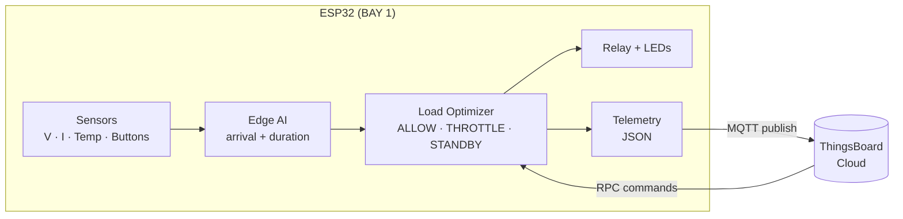
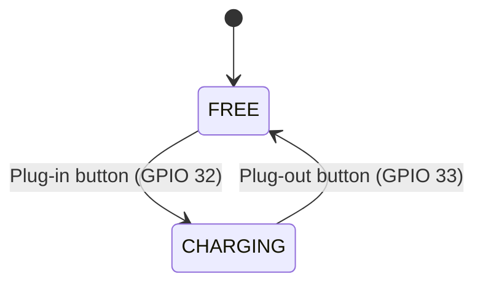

<div align="center">

# ⚡ Edge-AI Enabled EV Charging Bay
### Monitoring & Load Optimization System

**An ESP32 charging bay that predicts demand on-device, throttles load in real time, and reports to the cloud over MQTT.**

<br>


<br>

[Overview](#-overview) •
[Features](#-features) •
[Architecture](#-architecture) •
[Hardware](#-hardware) •
[Edge AI](#-edge-ai-models) •
[Getting Started](#-getting-started) •
[Cloud Interface](#-cloud-interface)

</div>

---

## 📖 Overview

Public EV chargers share a limited electrical supply. When several vehicles plug in at once, the station can exceed its safe load, especially during peak-tariff hours.

This project implements one smart **charging bay (BAY 1)** that handles this locally on an **ESP32**:

1. **Senses** voltage, current, power, temperature and bay occupancy.
2. **Predicts** the probability of a vehicle arriving and how long the current session will last, using ML models that run **on the microcontroller itself** (no cloud round-trip).
3. **Decides** whether to `ALLOW`, `THROTTLE` or hold `STANDBY` for the bay.
4. **Reports** everything to **ThingsBoard** over MQTT and accepts remote commands back.

The whole system runs in the **Wokwi** simulator, so you can try it without any hardware.

---

## ✨ Features

| | Feature | Details |
|---|---|---|
| 🔌 | **Bay state machine** | `FREE` ⇄ `CHARGING`, driven by plug-in / plug-out buttons |
| 📡 | **Multi-channel sensing** | Voltage (0–250 V), current (0–32 A), power, temperature (DHT22), bay status |
| 🧠 | **On-device edge AI** | Logistic Regression for arrival probability, Decision Tree for session duration |
| ⚖️ | **Load optimization** | Overcurrent and station-cap throttling, peak-tariff standby logic |
| 🔁 | **Relay control** | Throttle level applied through relay duty-cycling |
| 🚦 | **Status LEDs** | Green = free, Yellow = charging, Red = overload |
| ☁️ | **Cloud telemetry** | JSON over MQTT to ThingsBoard every 2 seconds |
| 🎛️ | **Remote control (RPC)** | `setRelayState` and `setThrottle` with manual override |
| 🕒 | **Real-time clock** | NTP time sync for hour-of-day and day-of-week features |

---

## 🏗️ Architecture

### System flow



### Bay state machine



### Main loop

Every **2 seconds** the firmware runs this pipeline. Button handling and LED updates run on every pass.

```
sample_sensors()  →  runEdgeAIInference()  →  runOptimization()  →  publishTelemetry()
```

---

## 🧠 Edge AI Models

Two lightweight models are exported to C++ (`ev-charging-bay-firmware/src/model.h`) and run directly on the ESP32.

| Model | Algorithm | Output | Export tool |
|---|---|---|---|
| **Arrival prediction** | Logistic Regression (sigmoid) | Probability 0–1 of a vehicle arriving | m2cgen |
| **Session duration** | Decision Tree Regressor | Estimated remaining charging minutes | micromlgen |

**Input features (6):** hour of day · day of week · bay occupied · recent average current · session elapsed minutes · historical arrival rate

---

## ⚖️ Load Optimization Logic

Decisions are made every cycle and skipped while a manual RPC override is active.

| Condition | Decision | Throttle |
|---|---|---|
| Charging and current above overload limit | `THROTTLE` + overload flag | 50 % |
| Charging, station power above cap, predicted duration > 10 min | `THROTTLE` | 70 % |
| Charging, within all limits | `ALLOW` | 100 % |
| Free, peak-tariff hour, arrival probability ≥ threshold | `STANDBY_EXPECTING` | n/a |
| Free, peak-tariff hour, low arrival probability | `LOW_DEMAND` | n/a |

**Default parameters** (in `ev-charging-bay-firmware/src/State.cpp`):

| Parameter | Default |
|---|---|
| Overload current | 16 A |
| Station power cap | 3000 W |
| Peak tariff window | 18:00 – 21:00 |
| Prediction threshold | 0.5 |
| Duty-cycle window | 2000 ms |

---

## 🔧 Hardware

Simulated in Wokwi; the circuit is defined in `ev-charging-bay-firmware/test/diagram.json`.

| Component | GPIO | Role |
|---|---|---|
| Potentiometer | 34 | Voltage input (ADC, 0–250 V) |
| Potentiometer | 35 | Current input (ADC, 0–32 A) |
| DHT22 | 15 | Temperature sensor |
| Relay module | 26 | Charging contactor |
| Push button (green) | 32 | Plug in |
| Push button (red) | 33 | Plug out |
| LED green | 18 | Bay free |
| LED yellow | 19 | Bay charging |
| LED red | 21 | Overload |

Pin definitions live in `ev-charging-bay-firmware/include/config.h`.

---

## ☁️ Cloud Interface

### Telemetry

Published to `v1/devices/me/telemetry`:

```json
{
  "bayId": "BAY 1",
  "voltage": 230.4,
  "current": 12.8,
  "power": 2949.1,
  "temperature": 27.5,
  "bayStatus": "CHARGING",
  "predictedArrivalProb": 0.58,
  "predictedDurationMin": 24,
  "loadDecision": "ALLOW",
  "throttleLevel": 100,
  "overloadActive": false
}
```

> Values above are illustrative.

### Remote commands (RPC)

Requests arrive on `v1/devices/me/rpc/request/+` and are answered on `v1/devices/me/rpc/response/<id>`.

| Method | Params | Effect |
|---|---|---|
| `setRelayState` | `{"state": true}` | Turns the relay on or off and engages manual override |
| `setThrottle` | `{"level": 70}` | Sets throttle from 0 to 100 and engages manual override |

---

## 📁 Project Structure

```
edge-ai-ev-charging-bay-monitoring/
└── ev-charging-bay-firmware/
    ├── src/
    │   ├── main.cpp            # setup() and 2-second main loop
    │   ├── config.cpp          # WiFi, MQTT server, device token
    │   ├── Network.cpp         # WiFi + MQTT connection and callback
    │   ├── Peripherals.cpp     # Sensor sampling, plug-in / plug-out buttons
    │   ├── State.cpp           # Global bay state and tunable parameters
    │   ├── edge_ai.cpp         # Feature building and model inference
    │   ├── model.h             # Generated ML models (do not hand-edit)
    │   ├── optimization.cpp    # Load decisions, relay duty-cycle, LEDs
    │   ├── Telemetry.cpp       # JSON telemetry publisher
    │   ├── rpc.cpp             # RPC command handler
    │   └── attributes.cpp      # Shared-attribute helpers
    ├── include/                # Header for each source module
    ├── lib/                    # Private libraries (empty)
    ├── test/
    │   ├── diagram.json        # Wokwi circuit
    │   └── wokwi.toml          # Wokwi firmware paths
    └── platformio.ini          # Board, framework, dependencies
```

---

## 🚀 Getting Started

### Prerequisites

- [VS Code](https://code.visualstudio.com/) with the **PlatformIO IDE** extension
- **Wokwi for VS Code** extension
- A [ThingsBoard Cloud](https://thingsboard.cloud/) account with one device created

### Setup

**1. Clone the repository**

```bash
git clone https://github.com/SuhaskumarR/edge-ai-ev-charging-bay-monitoring.git
cd edge-ai-ev-charging-bay-monitoring/ev-charging-bay-firmware
```

**2. Add your ThingsBoard device token**

Open `src/config.cpp` and replace the placeholder:

```cpp
const char* TB_TOKEN = "YOUR_THINGSBOARD_DEVICE_ACCESS_TOKEN";
```

WiFi is preset to `Wokwi-GUEST`, which the simulator provides.

**3. Build**

Open the `ev-charging-bay-firmware` folder in VS Code and let PlatformIO install the libraries, or run:

```bash
pio run
```

**4. Simulate**

Press **F1** and choose **Wokwi: Start Simulator**. Use the green button to plug in, the red button to plug out, and the potentiometers to change voltage and current.

### Dependencies

Declared in `platformio.ini` and installed automatically:

| Library | Purpose |
|---|---|
| `knolleary/PubSubClient` | MQTT client |
| `bblanchon/ArduinoJson` | JSON telemetry and RPC parsing |
| `adafruit/DHT sensor library` | DHT22 temperature sensor |
| `adafruit/Adafruit Unified Sensor` | Sensor abstraction layer |

**Board:** `esp32doit-devkit-v1` · **Framework:** Arduino

> 🔐 **Security:** never commit a real device access token. This repository ships with a placeholder.

---

## 🗺️ Roadmap

- [ ] Wire up shared attributes (`attributes.cpp`) from the MQTT connect and callback paths
- [ ] Call `applyRelayDutyCycle()` from the main loop to apply throttling on the relay
- [ ] Replace `recentAvgCurrent()` with a true rolling-window average
- [ ] Add the model training and dataset scripts that generate `model.h`
- [ ] Add screenshots of the Wokwi circuit and ThingsBoard dashboard
- [ ] Extend to multiple bays with station-wide load aggregation

<!--
Screenshots: put images in a docs/images/ folder and add them here, e.g.


-->

---

## 🛠️ Tech Stack

`ESP32` · `C++` · `PlatformIO` · `MQTT` · `ThingsBoard` · `Edge AI` · `Logistic Regression` · `Decision Tree` · `ArduinoJson` · `DHT22` · `ADC` · `GPIO` · `Wi-Fi` · `Embedded Systems`

---

## 👤 Author

**Suhaskumar R**
B.E. Electronics and Communication Engineering, Bangalore Institute of Technology

[](https://github.com/SuhaskumarR)

<div align="center">

⭐ If you found this project useful, consider giving it a star.

</div>
